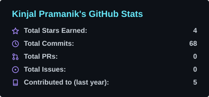
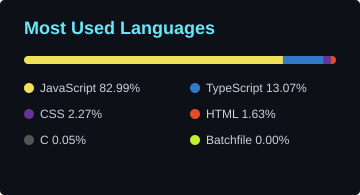
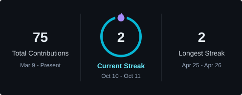

---

## 👋 Hey, I'm Kinjal

I'm a Computer Science student who learns by creating. I like breaking things down, understanding how they really work, and then building something useful on top.

- 🎓 **Studying:** Computer Science Engineering
- 🧠 **Sharpening:** data structures, algorithms, problem solving
- 🛠️ **Building:** practical projects, one iteration at a time
- 🌱 **Exploring:** Java, OOP, web development, AI/ML

## ⚡ Tech Stack

<!-- TECH-STACK-START -->

  
  
  
  
  
  
  
  
  

<!-- TECH-STACK-END -->

## 🚀 Featured Projects

<!--START_SECTION:projects-->
### 📌 [HealthGuard_Prototype](https://github.com/KinjalPramanik06/HealthGuard_Prototype)

HealthGuard — Smarter Health. Safer Lives.

CSS · Fork
<!--END_SECTION:projects-->

---

## 📚 Learning Journey

I'm building strong fundamentals in programming and problem solving, while exploring modern web development and AI/ML:

<table>
<tr>
<td align="center" width="25%">
   
  <b>Java &amp; OOP</b>
</td>
<td align="center" width="25%">
  
   
  <b>Data Structures &amp; Algorithms</b>
</td>
<td align="center" width="25%">
  
  
   
  <b>Web Development</b>
</td>
<td align="center" width="25%">
   
  <b>AI / ML</b>
</td>
</tr>
</table>

## 📊 GitHub Analytics

## ⚡ Recent GitHub Activity

<!--START_SECTION:activity-->
1. ⬆️ Pushed changes to [KinjalPramanik06/DSA-C-Program](https://github.com/KinjalPramanik06/DSA-C-Program) · Oct 27
2. ⬆️ Pushed changes to [KinjalPramanik06/DSA-C-Program](https://github.com/KinjalPramanik06/DSA-C-Program) · Oct 26
3. ⬆️ Pushed changes to [KinjalPramanik06/DSA-C-Program](https://github.com/KinjalPramanik06/DSA-C-Program) · Oct 25
4. ⬆️ Pushed changes to [KinjalPramanik06/DSA-C-Program](https://github.com/KinjalPramanik06/DSA-C-Program) · Oct 24
5. ⬆️ Pushed changes to [KinjalPramanik06/DSA-C-Program](https://github.com/KinjalPramanik06/DSA-C-Program) · Oct 22
6. ⬆️ Pushed changes to [KinjalPramanik06/DSA-C-Program](https://github.com/KinjalPramanik06/DSA-C-Program) · Oct 20
<!--END_SECTION:activity-->

## 🛠️ My Favorite Tools

<!--START_SECTION:tools-->
### 👨‍💻 Programming and Markup Languages

  
  
  
  
  
  
  
  

### 🧰 Frameworks and Libraries

  
  
  
  
  

### 🗄️ Databases and Hosting

  
  
  

### 💻 Software and Tools

  
  
  
  

<!--END_SECTION:tools-->

## 🤝 Connect With Me

*Keep learning. Keep building*

